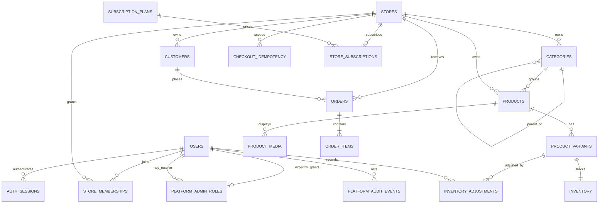

# PostgreSQL ERD and tenant constraints

Phases 2–6 implement identity, tenancy, catalog, media metadata, inventory, customers, COD orders, order items, checkout idempotency, subscription plans/status, and platform audit events. Tenant-owned records preserve store ownership through scoped queries and composite constraints.

## Implemented tenant-owned entities

- `stores`: tenant root; globally unique slug and constrained lifecycle status.
- `store_memberships`: composite key `(store_id, user_id)`; active status; constrained role.
- `categories`: store-owned hierarchy with per-store slug uniqueness; parent relationships stay within the same store.
- `products`: store-owned title, category, description, and draft/published/archived status.
- `product_variants`: store and product association, per-store SKU, integer minor-unit price, currency, and option map.
- `product_media`: store/product ownership, unique object key, validated image type/size metadata, and uploader identity.
- `inventory`: one row per store/variant, on-hand and reserved quantity constraints.
- `inventory_adjustments`: append-only stock delta, reason, actor, and timestamp.
- `users` and `auth_sessions`: platform identity/session data, not tenant-owned.
- `customers`, `orders`, `order_items`, and `checkout_idempotency`: store-scoped contact, shipping, immutable item snapshots, COD status, and replay protection. Composite foreign keys keep customer, order, and variant associations within one store.
- `subscription_plans` and `store_subscriptions`: platform-managed plan catalog and one current plan/status per store. Payment collection is not connected; plan prices and MRR are informational until a billing provider is integrated.
- `platform_admin_roles` and `platform_audit_events`: explicit global administrator grants and an append-oriented record of sensitive platform actions.

Every catalog association includes the store key in a composite foreign key. A variant cannot reference another store's product, a product cannot reference another store's category, and media/inventory cannot reference a foreign product/variant. Store IDs are also filtered in every service query.

## Future tenant entities

Subscriptions and store settings are planned. Use composite parent keys such as `UNIQUE (store_id, id)` and composite foreign keys for every tenant-owned association. Order items snapshot SKU, names, unit amount, and quantity so catalog edits do not rewrite order history. Money uses integer minor units, never floating point.

## RLS decision

PostgreSQL row-level security remains a defense-in-depth follow-up. Before enabling it, use transaction-scoped `SET LOCAL app.current_store_id`, ensure every request begins and ends a transaction safely, reset context on pooled connection reuse, and make missing context fail closed. Composite constraints and explicit tenant predicates remain required. Add RLS with PostgreSQL integration tests, not SQLite.
